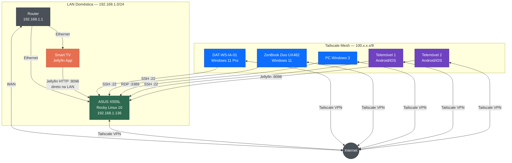
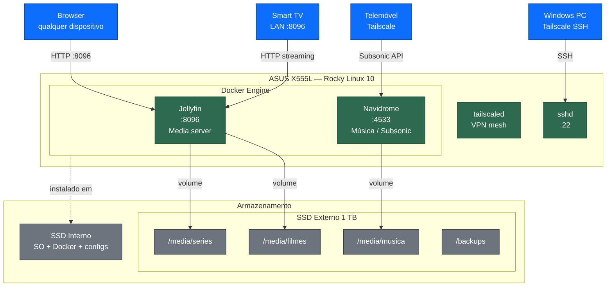
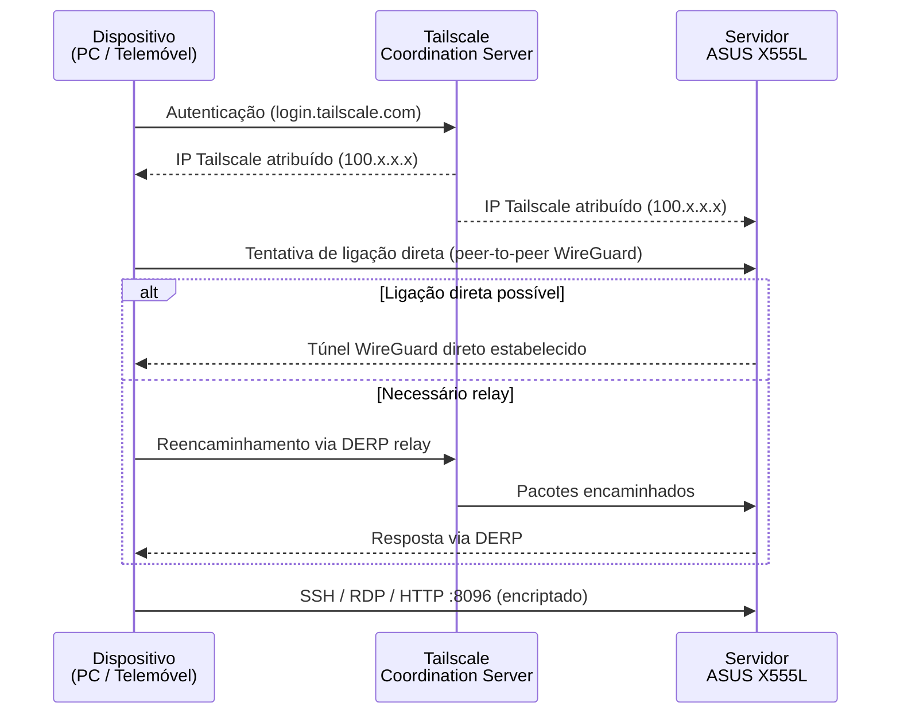

# Diagramas de Rede — Home Server + Tailscale

---

## 1. Topologia de Rede

Visão geral da infraestrutura: LAN doméstica, Tailscale VPN mesh e protocolos de acesso por dispositivo.

> **Nota:** A comunicação via Tailscale é peer-to-peer sempre que possível (sem passar pelos servidores DERP). A Internet aparece no diagrama apenas como representação simplificada do caminho VPN.

---

## 2. Arquitetura de Serviços do Servidor

Serviços a correr no ASUS X555L e mapeamento de volumes para o armazenamento externo.

---

## 3. Fluxo de Acesso — Tailscale

Como um dispositivo externo acede ao servidor via Tailscale.

---

*Atualizado em 2026-06-26 — Kody para Ivan / DAT*
