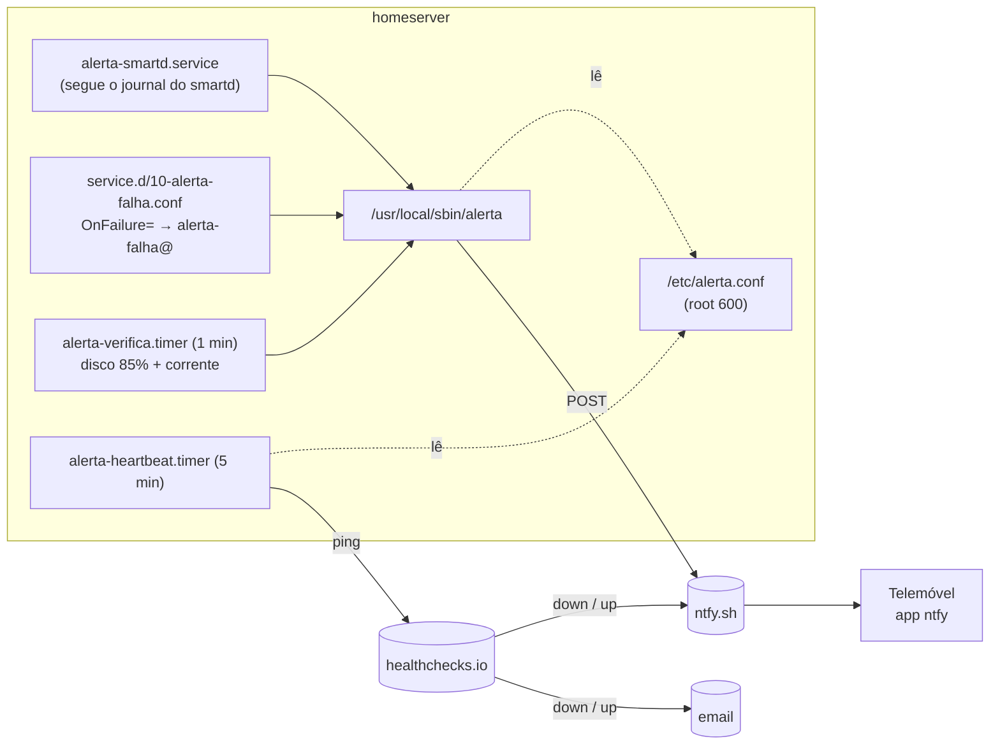

# Alertas do homeserver — ntfy, healthchecks.io e systemd

> Criado a 2026-10-20, no fecho da tarefa 21. Decisões de 2026-10-18 e passos 1 a 7 feitos entre 2026-10-18 e 2026-10-20. O tópico ntfy e o Ping URL **não aparecem aqui** (são segredos e vivem só em `/etc/alerta.conf`).

---

## O que é

Um canal de alertas que leva os problemas do servidor até ao telemóvel do Ivan, sem depender de email nem de ele ir ver os logs. Tem duas metades com lógicas opostas:

| Metade | Lógica | Apanha |
|---|---|---|
| **Alertas ativos** (ntfy.sh) | O servidor **empurra** uma mensagem quando vê um problema | Disco a falhar (SMART), serviço falhado, disco a 85%, falta de corrente |
| **Heartbeat** (healthchecks.io) | O servidor dá **sinal de vida** a cada 5 min; quem avisa é o serviço externo quando o sinal pára | Servidor morto, sem rede ou sem corrente (casos em que ele não consegue avisar ninguém) |

**ntfy** é um serviço de notificações *push* por HTTP: um `POST` para `https://ntfy.sh/<tópico>` chega a todas as apps subscritas a esse tópico. No servidor público não há contas: **quem souber o nome do tópico pode ler e escrever**, por isso o nome é aleatório e comprido e funciona como password.

**healthchecks.io** é um *dead man's switch*: cada *check* tem um período e uma tolerância; se não receber um ping dentro desse tempo, passa a "down" e notifica pelas integrações configuradas (aqui, ntfy e email).

**systemd** liga tudo: timers (em vez de cron), serviços *oneshot* e a diretiva `OnFailure=`, que arranca outra unit quando uma unit entra no estado `failed`.

---

## Aplicabilidade

- **Qualquer servidor doméstico ou pequeno VPS** sem equipa de operações: o problema típico não é a falha, é **ninguém dar por ela** durante semanas.
- **Alternativas maiores** para quando há muitos servidores: Prometheus + Alertmanager, Zabbix, Netdata, Uptime Kuma. Para um servidor só, são mais peças a manter do que aquilo que vigiam.
- **`OnFailure=` e drop-ins globais** (`service.d/`) são padrão geral do systemd e tema de **RHCSA** (gerir units, drop-ins, timers).
- **SELinux em `Enforcing`**: o passo 3 é um caso real de um domínio confinado a bloquear rede, e de como contornar sem abrir a política.

---

## Pertinência para este projeto

**O motivo:** os avisos iam para o correio local do `root`, que ninguém lê. Três problemas passaram semanas sem ninguém ver: o Wi-Fi em baixo desde 2026-09-01, o loop do `logind` (ver [09-logind-journald.md](09-logind-journald.md)) e o TraderScope a correr código antigo.

### Alternativas avaliadas (decisões de 2026-10-18)

| Alternativa | Avaliação |
|---|---|
| Email via `msmtp` (relay SMTP) | Rejeitado: mais peças (conta SMTP, password de aplicação) e o Ivan não lê o email a tempo |
| ntfy alojado no próprio servidor | Rejeitado: morre com o servidor, que é precisamente quando é preciso |
| **ntfy.sh público + tópico secreto** (escolhido) | Zero manutenção, app Android simples, prioridades e etiquetas. Risco aceite: quem souber o tópico lê os alertas (não contêm segredos) |
| **healthchecks.io gratuito** (escolhido) | Único que apanha o servidor morto. Integração direta com o ntfy, mais email como segundo canal |

### Decisões tomadas durante a implementação (2026-10-20)

| Decisão | Motivo |
|---|---|
| smartd por **serviço à parte** (`alerta-smartd`), não por `-M exec` | O SELinux executa o `-M exec` no domínio `smartdwarn_t`, sem DNS nem sockets (ver passo 3) |
| **Não** criar um módulo SELinux à medida (`audit2allow`) | Abria um domínio confinado e acrescentava regras a manter. Fica como exercício RHCSA |
| Anti-spam: smartd e `OnFailure=` não repetem durante 6 h, disco a cada 24 h | O smartd repete os avisos a cada 30 min; um timer que falha de hora a hora encheria o telemóvel |
| O "Não incomodar" do telemóvel é **sempre respeitado** | Decisão do Ivan: nenhum alerta justifica intervir de madrugada. Consequência: o que corre 24/7 tem de recuperar sozinho (`Restart=`) |
| Aviso de corrente só dado por feito **depois de o envio correr bem** | Num corte geral o router também cai; o aviso sai, com a hora real, quando a rede voltar |

### Mapa das peças



---

## Comandos utilizados

Todos os ficheiros foram copiados por `scp` para a pasta do `ivan` e instalados por scripts curtos corridos com `sudo bash ~/passoN.sh`, apagados depois. Há cópias de referência de todos em [../scripts/](../scripts/).

### Passo 1 — configuração secreta (2026-10-18)

`/etc/alerta.conf` com `NTFY_URL`, `NTFY_TOPICO` e (passo 5) `HC_PING_URL`, dono `root:root`, modo `600`, contexto `etc_t`. App ntfy no telemóvel com "Início automático" e bateria "Sem restrições" (no HyperOS, sem isto as notificações só chegam ao desbloquear).

### Passo 2 — o script `alerta`

```bash
sudo install -m 755 -o root -g root ~/alerta.novo /usr/local/sbin/alerta
sudo restorecon -v /usr/local/sbin/alerta
```

- `install`: copia e define dono e permissões de uma vez. Com `cp` o ficheiro ficava do `ivan` e era preciso `chown` + `chmod` à parte.
- `-m 755`: leitura e execução para todos, escrita só para o dono. Sem isto ficava com o modo por omissão (`755` no `install`, mas explícito é mais seguro).
- `-o root -g root`: dono e grupo `root`. Sem isto ficava do utilizador que corre o `install` (aqui `root` pelo `sudo`, mas explícito evita surpresas).
- `restorecon -v`: repõe o contexto SELinux que a política define para o caminho (`bin_t` em `/usr/local/sbin`). Sem isto, um ficheiro *movido* (`mv`) da pasta pessoal levaria `user_home_t` e o systemd recusava executá-lo. `-v` mostra o que mudou.

O envio dentro do script:

```bash
curl --silent --show-error --fail --max-time 15 --retry 3 --retry-delay 5 --retry-all-errors \
     --url-query "title=$titulo" --url-query "priority=$prioridade" --url-query "tags=$etiquetas" \
     --data-binary "$mensagem" "${NTFY_URL%/}/$NTFY_TOPICO"
```

- `--silent`: sem barra de progresso. Sem isto, o lixo da barra ia parar aos logs.
- `--show-error`: mesmo em `--silent`, mostra a mensagem de erro. Sem isto, uma falha era muda.
- `--fail`: um HTTP 4xx/5xx dá código de saída ≠ 0. Sem isto, o `curl` sai com 0 mesmo quando o ntfy recusa, e o script registava "enviado" por engano.
- `--max-time 15`: corta ao fim de 15 s. Sem isto, uma rede pendurada prendia o script indefinidamente.
- `--retry 3 --retry-delay 5`: até 3 novas tentativas, com 5 s entre elas.
- `--retry-all-errors`: repete em qualquer erro, não só nos "transitórios" que o `curl` reconhece. Sem isto, um erro de DNS não era repetido.
- `--url-query`: acrescenta parâmetros ao URL **já codificados** (`%C3%A3` para `ã`). Foi escolhido em vez de cabeçalhos HTTP (`-H "Title: ..."`), onde os acentos podem chegar estragados. Precisa de curl ≥ 7.87 (o RHEL 10 tem 8.12).
- `--data-binary`: envia a mensagem tal como está. Com `-d`, o `curl` apagava as quebras de linha.
- `${NTFY_URL%/}`: tira uma `/` final, se existir, para não ficar `//` no URL.

**Pormenor do RHEL:** o `sudo` usa `secure_path`, que **não inclui** `/usr/local/sbin`. Por isso `sudo alerta` dá "command not found" e chama-se sempre `sudo /usr/local/sbin/alerta`. As units usam o caminho completo.

### Passo 3 — smartd (plano B)

**Primeira tentativa (falhou, como estava previsto):** `-M exec /usr/local/sbin/smartd-alerta` no `smartd.conf`. O journal mostrou `curl: (6) Could not resolve host: ntfy.sh` e o `ausearch` mostrou as negações:

```
avc: denied { create } ... comm="curl" scontext=system_u:system_r:smartdwarn_t:s0 ... tclass=udp_socket
avc: denied { read }   ... comm="curl" name="resolv.conf" ... tcontext=...:net_conf_t:s0 ...
avc: denied { create } ... comm="logger" ... tclass=unix_dgram_socket
```

O smartd corre em `fsdaemon_t` e o que ele executa por `-M exec` transita para `smartdwarn_t`, um domínio feito para mandar mail e `wall`, sem rede.

**Solução:** o `smartd.conf` voltou ao original (`cp -a smartd.conf.bak-2026-10-20 smartd.conf`) e um serviço à parte segue o journal:

```bash
journalctl --follow --lines=0 --identifier=smartd --priority=0..3 --output=cat
```

- `--follow`: fica à espera de linhas novas, como o `tail -f`. Sem isto, mostrava o que há e terminava.
- `--lines=0`: começa sem mostrar nada do passado. Sem isto, ao arrancar reenviava as últimas 10 linhas (e, num reinício, avisos já enviados).
- `--identifier=smartd`: só mensagens com `SYSLOG_IDENTIFIER=smartd`. Sem isto, apanhava o journal inteiro.
- `--priority=0..3`: só `emerg` a `err`. O smartd regista os problemas reais (setores pendentes, falha de saúde) como `crit` (2) e o funcionamento normal como `info` (6). Sem isto, cada arranque do smartd gerava alertas.
- `--output=cat`: só o texto, para a mensagem do alerta ficar limpa.

O serviço corre em `unconfined_service_t` (o domínio normal de um serviço em `/usr/local/sbin`), que pode ir à rede.

```bash
sudo systemctl enable --now alerta-smartd.service
```

- `enable`: cria o *symlink* em `multi-user.target.wants`, para arrancar no boot. Sem isto, só corria até ao próximo reboot.
- `--now`: arranca já, além de ativar. Sem isto, era preciso um `systemctl start` à parte.

### Passo 4 — `OnFailure=` global

```ini
# /etc/systemd/system/service.d/10-alerta-falha.conf
[Unit]
OnFailure=alerta-falha@%N.service
```

- `service.d/` (sem nome de unit): **drop-in de topo**, aplica-se a **todos** os serviços (systemd ≥ 245). Sem isto, era preciso um drop-in por serviço.
- `OnFailure=`: arranca a unit indicada quando esta entra em `failed`. Serviços com `Restart=` só lá chegam quando esgotam os reinícios.
- `%N`: nome da unit sem o sufixo (`sshd`). Com `%n` ficava `alerta-falha@sshd.service.service`.

```bash
sudo ln -sfn /dev/null /etc/systemd/system/alerta-falha@.service.d/10-alerta-falha.conf
```

- Um drop-in com **o mesmo nome** apontado para `/dev/null` anula o drop-in de topo **só nesta unit**. Sem isto, se o próprio alerta falhasse, chamava `alerta-falha@alerta-falha@…` em cadeia (o `man systemd.unit` avisa exatamente disto).
- `-s`: link simbólico. `-f`: substitui se já existir. `-n`: trata um destino que já seja link como ficheiro (não entra nele).

```bash
systemctl show sshd.service -p OnFailure --value
```

- `show -p OnFailure`: mostra o valor **em vigor** da propriedade, depois de juntar todos os drop-ins. Lição do doc 09: confirmar o valor real, não só o ficheiro.
- `--value`: só o valor, sem `OnFailure=`.

### Passo 5 — heartbeat

```ini
# /etc/systemd/system/alerta-heartbeat.timer
[Timer]
OnBootSec=1min
OnUnitActiveSec=5min
AccuracySec=30s
```

- `OnBootSec=1min`: primeiro disparo 1 min depois do arranque. Sem isto (só com `OnUnitActiveSec`), o timer nunca começava, porque a unit nunca tinha estado ativa.
- `OnUnitActiveSec=5min`: dispara 5 min depois da última ativação do serviço. É um timer **monotónico** (relativo), por isso o `systemctl show -p NextElapseUSecRealtime` sai vazio e a hora seguinte vê-se com `systemctl list-timers`.
- `AccuracySec=30s`: o systemd pode atrasar até 30 s para juntar disparos e poupar *wake-ups*. Por omissão é 1 min, demasiado para um período de 5.

O URL foi pedido com `read -rsp` dentro do script de instalação:
- `-r`: não interpreta `\`. `-s`: **não mostra** o que se escreve. `-p`: mostra o texto do pedido.

E validado com a expressão `^https://hc-ping\.com/[0-9a-f-]{36}$` antes de mexer no `alerta.conf`.

O check no healthchecks.io: **Simple**, período **5 min**, tolerância **10 min** (≈15 min do corte até ao aviso). Integrações: ntfy (mesmo tópico; *down* = High, *up* = Default) e email.

### Passos 6 e 7 — disco e corrente

```bash
df -h -x tmpfs -x devtmpfs -x overlay -x efivarfs -x squashfs --output=target,pcent,size
```

- `-h`: tamanhos legíveis (`70G`). Sem isto, blocos de 1 KB.
- `-x <tipo>`: exclui sistemas de ficheiros em RAM ou virtuais, que enchem e esvaziam sozinhos. Sem isto, o `/run` ou o `/dev/shm` podiam gerar alertas falsos.
- `--output=target,pcent,size`: só as três colunas usadas, numa ordem fixa. Sem isto, o *parsing* dependia do formato por omissão.

Corrente: `/sys/class/power_supply/AC0/online` (`1` = com corrente) e `/sys/class/power_supply/BAT0/capacity` (%). Lidos pelo kernel, não precisam de UPower nem de permissões especiais.

---

## Teste de validação

| Teste | Como | Resultado (2026-10-20) |
|---|---|---|
| ntfy, ecrã bloqueado | `curl` à mão (passo 1) | ✅ recebido (2026-10-18) |
| Acentos e etiquetas | `alerta -p 3 -t white_check_mark "…" "ã ç é ô €"` | ✅ tudo certo no telemóvel |
| Mensagem pelo stdin | `echo … \| alerta -p 2 "…"` | ✅ |
| Sem root | `alerta "sem root"` | ✅ erro esperado (não lê o `alerta.conf`) |
| smartd por `-M exec` | `-M test` no `smartd.conf` | ❌ SELinux (`smartdwarn_t`), como previsto, levou ao plano B |
| smartd, plano B | `logger -t smartd -p daemon.crit "TESTE…"` duas vezes | ✅ 1 alerta; a repetição foi suprimida; sem negações SELinux |
| `OnFailure=` | `teste-falha.service` com `exit 3`, arrancado duas vezes | ✅ 1 alerta com motivo e log; a 2.ª falha foi suprimida; sem recursão; unit de teste apagada |
| Integração healthchecks → ntfy | Botão **Test!** | ✅ "TEST is DOWN" recebido |
| Heartbeat | `systemctl start alerta-heartbeat.service` | ✅ `success`, check verde |
| Disco a 85% | `ALERTA_LIMITE_DISCO=60 alerta-verifica` (o `/boot` está a 65%) | ✅ 1 alerta; a repetição foi suprimida |

**Lição do "Não incomodar":** um alerta de prioridade 5 "não chegou"; estava na app, mas o Não incomodar escondeu a notificação. Quando um alerta parece não chegar, ver primeiro **dentro da app**.

**Por testar:**
- [ ] **Corrente:** desligar o carregador ~2 min e confirmar "Sem corrente desde as …" e "Corrente reposta às …" (tarefa 30(c), junto com o teste da bateria a 2%).
- [ ] **Servidor em baixo de verdade:** desligar a rede ou o servidor > 15 min e confirmar o "homeserver is DOWN" do healthchecks.io (e o "UP" no regresso).
- [ ] **Aviso de bateria a 20%:** só num corte longo, ou no teste dos 2%.

---

## Comandos de referência e troubleshooting

```bash
# Mandar um alerta à mão (sempre com caminho completo por causa do secure_path)
sudo /usr/local/sbin/alerta -p 3 -t information_source "Título" "Mensagem"

# O que foi enviado (ou falhou) — todas as fontes passam pelo alerta
journalctl -t alerta --since today

# Estado de todas as peças
systemctl status alerta-smartd.service --no-pager
systemctl list-timers 'alerta-*' --no-pager
systemctl show sshd.service -p OnFailure --value      # deve dar alerta-falha@sshd.service

# Logs de cada peça
journalctl -u alerta-smartd -n 20 --no-pager
journalctl -u 'alerta-falha@*' --since today --no-pager
journalctl -t alerta-heartbeat --since today          # só tem linhas se um ping falhar
journalctl -u alerta-verifica --since "-1h" --no-pager

# Estado anti-spam (em RAM; limpa-se num reboot)
ls -l /run/alerta-smartd /run/alerta-falha /run/alerta-verifica
sudo rm /run/alerta-falha/<unit>.service              # deixar uma unit voltar a alertar já

# Negações SELinux recentes
sudo ausearch -m avc -ts recent

# Testar o OnFailure= sem mexer em serviços reais
printf '[Service]\nType=oneshot\nExecStart=/bin/false\n' | sudo tee /etc/systemd/system/teste-falha.service
sudo systemctl daemon-reload && sudo systemctl start teste-falha.service
sudo rm /etc/systemd/system/teste-falha.service && sudo systemctl daemon-reload && sudo systemctl reset-failed

# Simular um aviso do smartd
sudo logger -t smartd -p daemon.crit "TESTE: Device: /dev/sdX, 1 Currently unreadable (pending) sectors"
```

| Sintoma | Causa provável | O que fazer |
|---|---|---|
| `sudo: alerta: command not found` | `secure_path` sem `/usr/local/sbin` | Usar `/usr/local/sbin/alerta` |
| Journal com `FALHOU o envio` | Sem rede, DNS, ou ntfy.sh em baixo | `curl -I https://ntfy.sh`; o heartbeat cobre o tempo sem rede |
| Alerta registado como enviado mas sem notificação | "Não incomodar" ou poupança de bateria do HyperOS | Ver dentro da app; confirmar "Início automático" e "Sem restrições" |
| Uma unit falhou e não houve alerta | Anti-spam de 6 h, ou a unit tem `Restart=` e ainda está a tentar | `ls /run/alerta-falha`; `systemctl status <unit>` |
| O healthchecks diz "down" mas o servidor está bem | Timer parado ou `HC_PING_URL` errado | `systemctl list-timers alerta-heartbeat.timer`; `journalctl -t alerta-heartbeat` |
| Mudou o tópico ntfy | — | Atualizar **dois** sítios: `/etc/alerta.conf` e a integração no healthchecks.io |
