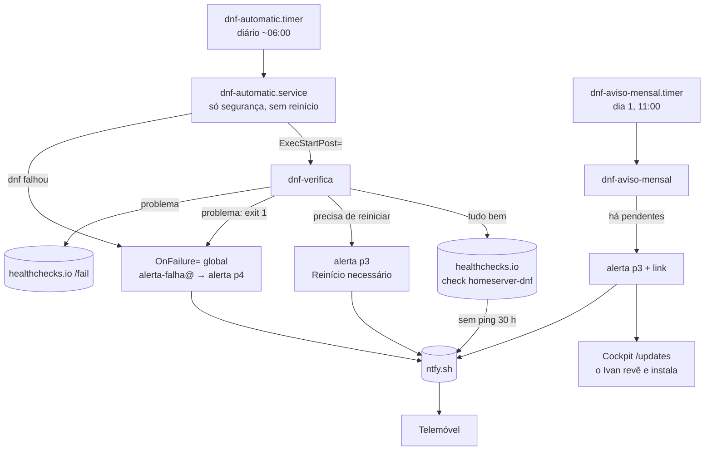

# Atualizações do homeserver — dnf-automatic, verificação do /boot e aviso mensal

> Criado a 2026-10-31, no mesmo dia da implementação, com os resultados reais dos testes. Documento de estudo aprovado pelo Ivan. O tópico ntfy e os Ping URLs **não aparecem aqui** (são segredos e vivem só em `/etc/alerta.conf`). Liga ao [10-alertas-ntfy-healthchecks.md](10-alertas-ntfy-healthchecks.md), cujas peças são reaproveitadas.

---

## O que é

Um sistema de atualizações em duas velocidades, com verificação própria e alertas:

| Parte | O que faz | Quem decide |
|---|---|---|
| **`dnf-automatic`** | Todos os dias, por volta das 06:00, instala **só as atualizações de segurança** | Automático; **nunca reinicia** |
| **`dnf-verifica`** | Depois de cada execução, confirma que o arranque está são (kernels, initramfs, espaço no `/boot`) e avisa se é preciso reiniciar | Automático; alerta no telemóvel |
| **`dnf-aviso-mensal`** | No dia 1 de cada mês avisa quantas atualizações **normais** estão pendentes, com um link para o Cockpit | **O Ivan** confirma e instala no Cockpit |

**`dnf-automatic`** é a ferramenta oficial do RHEL (pacote `dnf-automatic`, aqui a versão 4.20, do dnf 4) para correr o `dnf` sem ninguém: um timer do systemd chama `dnf-automatic`, que lê `/etc/dnf/automatic.conf` e, consoante a configuração, só verifica, descarrega ou também instala.

**`upgrade_type = security`** usa os metadados *updateinfo* dos repositórios da Red Hat: cada pacote corrigido vem associado a um aviso (RHSA) com a gravidade (Low, Moderate, Important, Critical). O dnf instala só os pacotes que têm um RHSA.

**Por que é que as atualizações de segurança são seguras de aplicar sozinhas em RHEL:** a Red Hat faz *backport* das correções. O pacote fica na mesma versão base (ex.: OpenSSH 9.9p1, de `-25` para `-29`) e muda só o necessário para corrigir a falha, por isso a configuração e o comportamento não mudam.

---

## Aplicabilidade

- **Qualquer servidor RHEL, Rocky, Alma ou Fedora sem equipa de operações.** O risco típico não é uma atualização partir alguma coisa; é **não haver atualizações durante meses**.
- **Ubuntu/Debian:** o equivalente é o `unattended-upgrades`, com a mesma ideia (segurança automática, o resto à mão).
- **Frotas maiores:** Red Hat Satellite, Foreman/Katello ou Ansible (`dnf` module) com janelas de manutenção. Para um servidor só, são mais peças do que aquilo que gerem.
- **RHCSA:** `dnf` (repositórios, `updateinfo`, `history`), timers e drop-ins do systemd, `ExecStartPost=`, `OnFailure=`, kernels (`installonly_limit`, `grubby`, `dracut`) e `restorecon` estão todos nos objetivos do exame.

---

## Pertinência para este projeto

**O motivo (2026-10-31):** não havia nada que instalasse atualizações. Existiam só o `dnf-makecache.timer` (atualiza a lista de pacotes, não instala nada) e o aviso do Cockpit. O aviso de 25/10 ficou 6 dias por tratar e, a 31/10, o `dnf updateinfo` mostrava **~200 pacotes de segurança em atraso desde a instalação de agosto**, incluindo kernel, OpenSSH, sudo, glibc, openssl e um `ca-certificates` **Critical**. Para um servidor ligado 24/7 na tailnet, e que vai receber o TraderScope em produção, isto não é aceitável.

### O incidente que mudou o desenho

O primeiro `sudo dnf upgrade --security` manual (31/10, 206 pacotes) **acabou com `Complete!`**, mas no meio tinha isto:

```
cp: error writing '/boot/initramfs-6.12.0-211.69.1.el10_2.x86_64.img.tmp': No space left on device
dracut[F]: Creation of /boot/initramfs-6.12.0-211.69.1.el10_2.x86_64.img.tmp failed
```

O `/boot` (960 MB) tinha **três kernels** (`installonly_limit=3`) mais a imagem *rescue*. A atualização do `microcode_ctl` mandou o dracut recriar os initramfs de todos os kernels, e cada um precisa de ~160 MB livres para o `.tmp`. Desta vez as imagens antigas ficaram intactas (o dracut só substitui o original no fim), mas **o dnf não falhou**. Se isto tivesse acontecido de madrugada, sem ninguém a ver, um kernel novo sem initramfs válido podia ficar como opção por omissão, e o servidor, que não tem ecrã, não voltava a arrancar.

**Lição:** o código de saída do `dnf` não chega para saber se uma atualização correu bem. Os erros dos *scriptlets* (`%post`, `%posttrans`) não fazem falhar a transação. Daí o `dnf-verifica`.

### Alternativas avaliadas

| Alternativa | Avaliação |
|---|---|
| Continuar à mão, quando alguém se lembrar | Rejeitada: é o que já tinha falhado |
| `dnf-automatic` com **todas** as atualizações | Rejeitada: as atualizações normais trazem versões novas (ex.: Firefox 140 → 153, firmware) e podem mudar o comportamento sem aviso |
| `dnf-automatic` só a descarregar e avisar | Rejeitada: continua a depender de alguém agir, e isso já tinha falhado |
| **`dnf-automatic` só segurança, sem reinício + verificação + aviso mensal para o resto** (escolhida) | Corrige o que é urgente sem intervenção; o resto passa pela confirmação do Ivan |
| Reinício automático (`reboot = when-needed`) | Rejeitada: o reinício fica sempre com o Ivan (TraderScope, testes em curso) |
| Aviso mensal com botão "Aplicar" no ntfy (o servidor ouve um tópico e corre o `dnf upgrade`) | Rejeitada (decisão do Ivan, 2026-10-31): quem soubesse o tópico podia pôr o servidor a fazer ações de root. Escolhido: o botão abre o **Cockpit**, que já existe e pede a password |

### Decisões tomadas

- **`installonly_limit=2`** (era 3): ficam o kernel atual e o anterior, mais o *rescue*. Com 3 kernels de ~230 MB (initramfs de 159 MB + kdump de 45 MB + vmlinuz/System.map), o `/boot` não tem espaço para o `.tmp` do dracut. Kernel de instalação `6.12.0-55.9.1.el10_0` removido.
- **Mínimo de 200 MB livres no `/boot`**, verificado depois de cada execução. Conta: quando entra um kernel novo, o dnf remove o mais antigo **antes** dos *scriptlets* finais, e o dracut precisa de espaço para um initramfs temporário (~160 MB) e para o vmlinuz (~16 MB).
- **Reutilizar a tarefa 21:** o `OnFailure=` global já alerta quando um serviço falha; o `dnf-verifica` só tem de sair com 1. O script `alerta` ganhou a opção `-u` (link).
- **Check próprio no healthchecks.io** (`homeserver-dnf`, 1 dia + 6 h): apanha o caso de o timer deixar de correr. O check `homeserver` (heartbeat de 5 min) não serve para isto.

### Mapa das peças



---

## Comandos utilizados

Os ficheiros foram copiados por `scp` para a pasta do `ivan` e instalados por scripts curtos corridos com `sudo bash ~/passo….sh`, apagados depois (o mesmo método do documento 10). As cópias de referência estão em [../scripts/](../scripts/).

### Passo 1 — atualizações de segurança em atraso (manual)

```bash
ssh -t homeserver 'sudo dnf updateinfo list --security; sudo dnf upgrade --security'
```

- `ssh -t`: pede um terminal à máquina remota. Sem isto, o `sudo` não consegue pedir a password e o `dnf` não pode perguntar `[y/N]`.
- `dnf updateinfo list --security`: lista os avisos de segurança (RHSA) que se aplicam aos pacotes instalados, com a gravidade. Sem `--security`, mostrava também as correções de bugs e as melhorias.
- `dnf upgrade --security`: atualiza só os pacotes com RHSA. Sem `--security`, atualizava tudo (aqui teriam sido +77 pacotes).
- **Atenção:** corrido sem `sudo`, o `dnf` pediu para importar a chave GPG da Tailscale e falhou. Não é um problema do repositório; o utilizador normal não tem acesso ao porta-chaves do RPM (já registado no `CLAUDE.md` a 2026-10-11).

### Passo 2 — corrigir o `/boot`

```bash
sudo lsinitrd /boot/initramfs-6.12.0-211.69.1.el10_2.x86_64.img | head -4
sudo grubby --default-kernel
sudo dnf remove kernel-core-6.12.0-55.9.1.el10_0.x86_64
sudo sed -i "s/^installonly_limit=3$/installonly_limit=2/" /etc/dnf/dnf.conf
sudo dracut -f --kver 6.12.0-211.69.1.el10_2.x86_64
sudo dracut -f --kver 6.12.0-211.44.1.el10_2.x86_64
```

- `lsinitrd <imagem>`: lista o conteúdo de um initramfs. Se a imagem estiver cortada, a lista para a meio. `| head -4` mostra só o cabeçalho (tamanho e "Early CPIO image", que traz o microcódigo do CPU).
- `grubby --default-kernel`: mostra o kernel com que o GRUB arranca por omissão. Era o novo (`211.69.1`), por isso a imagem dele **tinha** de estar boa antes de reiniciar.
- `dnf remove kernel-core-<versão>`: remove esse kernel e os pacotes que dependem dele (`kernel`, `kernel-modules*` da mesma versão). Dar a versão completa é essencial: só `kernel-core` removia todos os kernels que o dnf deixasse remover. O dnf **nunca** remove o kernel em uso.
- `sed -i "s/^installonly_limit=3$/installonly_limit=2/"`: troca o valor no próprio ficheiro (`-i`). `^` e `$` obrigam a linha a ser exatamente essa; sem eles, apanhava também uma linha comentada ou com outro valor.
- `dracut -f --kver <versão>`: recria o initramfs desse kernel. `-f` (*force*) substitui o que existe; sem ele, o dracut recusa porque o ficheiro já existe. `--kver` escolhe o kernel; sem ele, usava o kernel **em uso**, e o do kernel novo ficava por refazer.
- Os passos foram encadeados com `&&`: se um falhasse, os seguintes não corriam.

Resultado: `/boot` de 84% para 67% (326 MB livres); as duas imagens recriadas às 10:06 e 10:07.

### Passo 3 — `dnf-automatic`

```bash
dnf -y install dnf-automatic
```

- `-y`: responde "sim" à confirmação. Aqui era aceitável porque o script instalava um pacote conhecido; numa atualização geral, ver a lista primeiro é melhor.

Em `/etc/dnf/automatic.conf`, secção `[commands]` (cópia do original em `automatic.conf.bak-2026-10-31`):

```ini
upgrade_type = security
download_updates = yes
apply_updates = yes
reboot = never
```

- `upgrade_type = security`: só pacotes com RHSA. O valor por omissão (`default`) instala tudo.
- `download_updates = yes`: descarrega os pacotes. Sem isto, o dnf-automatic só verificava se havia atualizações.
- `apply_updates = yes`: instala. Sem isto, descarregava e ficava por aí (o valor por omissão no RHEL é `no`).
- `reboot = never`: nunca reinicia. As outras opções são `when-changed` e `when-needed`, que corriam o `reboot_command` (`shutdown -r +5`) sozinhas.
- `random_sleep = 0` (já vinha assim): não junta um atraso aleatório próprio, porque o timer já tem um.

O timer vem com o pacote (`systemctl cat dnf-automatic.timer`):

```ini
[Timer]
OnCalendar=*-*-* 6:00
RandomizedDelaySec=60m
Persistent=true
```

- `OnCalendar=*-*-* 6:00`: todos os dias às 06:00.
- `RandomizedDelaySec=60m`: atraso aleatório até 60 min. Serve para milhares de servidores não irem todos aos repositórios no mesmo segundo. Primeira execução marcada para as 06:11.
- `Persistent=true`: se o servidor estava desligado à hora marcada, corre logo no arranque seguinte.

```bash
systemctl enable --now dnf-automatic.timer
```

- `enable`: liga o timer em todos os arranques (cria o *symlink* em `timers.target.wants`).
- `--now`: arranca-o já. Sem isto, ficava ativo só a partir do próximo arranque.

### Passo 4 — `dnf-verifica` como `ExecStartPost=`

```ini
# /etc/systemd/system/dnf-automatic.service.d/10-verifica.conf
[Service]
ExecStartPost=/usr/local/sbin/dnf-verifica
```

- **Drop-in** (`<unit>.service.d/*.conf`): acrescenta à unit do pacote sem a editar. Editar `/usr/lib/systemd/system/dnf-automatic.service` diretamente seria desfeito na próxima atualização do pacote.
- `ExecStartPost=`: corre depois do `ExecStart=` terminar com sucesso (numa unit `Type=oneshot`, quando o processo acaba). Se o `ExecStartPost=` sair com código ≠ 0, a unit fica `failed`, e o `OnFailure=` global (documento 10) manda o alerta. Se o próprio dnf falhar, o `ExecStartPost=` não corre, mas a unit também fica `failed` e o alerta sai na mesma.

```bash
install -m 755 -o root -g root ~ivan/dnf-verifica /usr/local/sbin/dnf-verifica
restorecon -v /usr/local/sbin/dnf-verifica
systemctl daemon-reload
systemctl cat dnf-automatic.service
```

- `install -m 755 -o root -g root`: copia e define permissões e dono de uma vez (explicado no documento 10, passo 2).
- `restorecon -v`: dá ao ficheiro o contexto SELinux certo para `/usr/local/sbin` (`bin_t`). Sem isto, o ficheiro vindo da pasta pessoal ficava `user_home_t` e o systemd recusava executá-lo.
- `systemctl daemon-reload`: faz o systemd reler as units e os drop-ins. Sem isto, o drop-in novo só contava depois do próximo arranque.
- `systemctl cat`: mostra a unit **com todos os drop-ins**, pela ordem em que se aplicam. Confirmou três origens: a unit do pacote, o `OnFailure=` global e o `ExecStartPost=` novo.

O que o `dnf-verifica` confirma (ver o script):

| Verificação | Como | Porquê |
|---|---|---|
| vmlinuz de cada kernel | `rpm -q kernel-core --qf '%{VERSION}-%{RELEASE}.%{ARCH}\n'` + `-s` (existe e não está vazio) | `--qf` (*query format*) dá exatamente a versão usada nos nomes dos ficheiros |
| initramfs legível | `lsinitrd  \| grep -q usr/lib/modules/<versão>/modules.dep` | Uma imagem cortada a meio lista só parte do conteúdo; o `modules.dep` não aparece (testado) |
| Restos do dracut | `/boot/*.tmp` | Um `.tmp` é sinal de que um dracut não terminou |
| Espaço | `df --output=avail -m /boot` ≥ 200 MB | `--output=avail` dá só a coluna "disponível"; `-m` em MB, para comparar com um número inteiro |
| Reinício | `dnf -q -C needs-restarting -r` | `-r` diz só se é preciso reiniciar (código 1 = sim) e porquê; `-C` usa só a cache, sem ir à rede; `-q` tira as mensagens do dnf |

Custo: ~54 s de CPU por execução, quase tudo nos dois `lsinitrd` (descomprimem 159 MB cada). Uma vez por dia, com `Nice=19` herdado da unit, não pesa.

### Passo 5 — check próprio no healthchecks.io

Check `homeserver-dnf` (Simple, período **1 day**, tolerância **6 hours**, integrações ntfy + email). Ping URL acrescentado a `/etc/alerta.conf` como `HC_DNF_PING_URL` (cópia em `alerta.conf.bak-2026-10-31`):

```bash
read -rsp "Ping URL do homeserver-dnf (versão uuid): " u; echo
u=$(printf %s "$u" | tr -d "[:space:]")
[[ $u =~ ^https://hc-ping\.com/[0-9a-f-]{36}$ ]] && echo "HC_DNF_PING_URL=$u" | sudo tee -a /etc/alerta.conf >/dev/null
```

- `read -rsp`: `-r` não interpreta `\`; `-s` não mostra o que se cola (o URL é um segredo); `-p` mostra o texto do pedido.
- `tr -d "[:space:]"`: tira espaços e mudanças de linha. **Lição:** a primeira tentativa foi recusada pela validação, provavelmente por um espaço ou uma mudança de linha que veio com o texto copiado.
- `=~ ^https://hc-ping\.com/[0-9a-f-]{36}$`: só aceita o URL na forma *uuid* (36 caracteres). A forma *slug* do painel tem outro formato e seria recusada.
- `sudo tee -a`: acrescenta (`-a`) ao ficheiro como root. Um `sudo echo … >> ficheiro` não funcionava, porque o `>>` é feito pela shell do `ivan`, sem permissão.
- **Erro a evitar:** usar o Ping URL do check `homeserver` (heartbeat de 5 min). Os dois tipos de ping misturavam-se e o check deixava de servir para os dois.

O `dnf-verifica` faz ping a `$HC_DNF_PING_URL` quando corre bem e a `$HC_DNF_PING_URL/fail` quando encontra um problema (o `/fail` põe o check em "down" logo, sem esperar pela tolerância).

### Passo 6 — aviso mensal com link para o Cockpit

Decisão do Ivan (2026-10-31): as atualizações normais ficam à espera de confirmação, e o aviso é **automático**.

```ini
# dnf-aviso-mensal.timer
[Timer]
OnCalendar=*-*-01 11:00:00
Persistent=true
```

- `*-*-01 11:00:00`: qualquer ano, qualquer mês, dia 1, às 11:00 (a meio da manhã, para não cair no "Não incomodar" da noite).
- `Persistent=true`: se o servidor estava desligado, corre no arranque seguinte.

O script `dnf-aviso-mensal`:

```bash
dnf -q check-update --refresh
```

- `check-update`: lista as atualizações disponíveis **sem instalar**. Código de saída **100** = há atualizações, **0** = nenhuma, **1** = erro. É o código, e não o texto, que o script usa para decidir.
- `--refresh`: força a atualização dos metadados antes. Sem isto, podia usar uma cache com horas.

Se houver pendentes, manda um ntfy p3 com `-u https://homeserver:9090/updates`. A opção nova do `alerta`:

```bash
--url-query "click=$link" --url-query "actions=view, Abrir, $link"
```

- `click=`: o ntfy abre o link quando se toca na notificação.
- `actions=view, Abrir, <link>`: acrescenta um botão "Abrir" que faz o mesmo (ação `view` do ntfy). Mais visível do que o toque.
- `https://homeserver:9090/updates`: página de atualizações do Cockpit (`cockpit-packagekit`), pela tailnet (MagicDNS). Mostra a lista, instala e, se for preciso, oferece reiniciar. Na primeira vez, o browser avisa do certificado do Cockpit (autoassinado).

### Passo 7 — correção de um bug do documento 10 (`alerta-falha`)

O primeiro teste de falha mostrou `código de saída: 0 | reinícios: 1`, quando o log dizia `status=1/FAILURE`. Causa:

```bash
systemctl show sshd.service -p Result -p ExecMainStatus -p NRestarts --value
```

O `systemctl show` devolve as propriedades **pela ordem interna dele** (Result, NRestarts, ExecMainStatus), e não pela ordem dos `-p`. O `alerta-falha` lia-as pela ordem pedida, por isso **desde 2026-10-20 o código de saída e os reinícios saíam trocados**. Correção: uma propriedade de cada vez (`systemctl show <unit> -p <propriedade> --value`). Cópia da versão antiga em `/usr/local/sbin/alerta-falha.bak-2026-10-31`.

---

## Teste de validação

| O quê | Como | Resultado (2026-10-31) |
|---|---|---|
| Configuração | `sed -n '/^\[commands\]/,/^\[/p' /etc/dnf/automatic.conf` | ✅ `security`, `yes`, `yes`, `never` |
| Drop-in em vigor | `systemctl cat dnf-automatic.service` | ✅ `ExecStartPost=` e `OnFailure=` presentes |
| Ponta a ponta | `systemctl start dnf-automatic.service` | ✅ "No security updates needed, but 77 updates available"; "OK: 2 kernels com initramfs legível, /boot com 326 MB livres"; "Reinício necessário" enviado |
| Healthchecks | `curl` ao Ping URL | ✅ resposta `OK`; check a verde |
| Reinício | `uname -r`; `dnf needs-restarting -r` | ✅ kernel `6.12.0-211.69.1`; "Reboot should not be necessary"; 0 units `failed`; Tailscale e Cockpit ativos; `/boot` 71% (o kdump criou a imagem do kernel novo, +45 MB) |
| Caminho de falha | `systemd-run --unit=teste-dnf-verifica --wait -E BOOT_MIN_LIVRE_MB=5000 -E DNF_VERIFICA_TESTE=1 /usr/local/sbin/dnf-verifica` | ✅ alerta p4 "Serviço falhou: teste-dnf-verifica.service" com o motivo; depois da correção do passo 7, "código de saída: 1 \| reinícios: 0" |
| initramfs cortado | `head -c 60M  > /tmp/…` + `lsinitrd \| grep modules.dep` | ✅ "em falta → o dnf-verifica deteta" |
| Link para o Cockpit | `alerta -p 4 -u https://homeserver:9090/updates …` | ✅ tocar na notificação abre a página de atualizações |
| Aviso mensal | `dnf-aviso-mensal` com 0 pendentes | ✅ calado; timer para 2026-11-01 11:00 |

Flags do teste de falha:
- `systemd-run`: corre um comando como uma unit **transitória**. Serve para testar dentro do systemd (e com o `OnFailure=` global, que também se aplica a units transitórias) sem criar ficheiros.
- `--unit=teste-dnf-verifica`: nome fixo, para ler o log e fazer `reset-failed` a seguir.
- `--wait`: espera que acabe e devolve o código de saída.
- `-E VAR=valor`: variável de ambiente. `BOOT_MIN_LIVRE_MB=5000` força a falha; `DNF_VERIFICA_TESTE=1` não faz o ping `/fail` ao healthchecks, para não sujar o histórico do check.

**Por testar / observado:**
- ~~Notificações p3 silenciosas no telemóvel~~ **resolvido a 2026-10-31:** o "Reinício necessário" (p3) chegou à app mas não fez notificação; as p4 tocavam. Causa: o canal Android "Default priority" da app ntfy estava em silêncio (HyperOS). Depois de o ativar (som + pop-up + ecrã de bloqueio), um teste p3 chegou com som e vibração, de ecrã bloqueado.
- A primeira execução real do timer (01/11 ~06:11) e o primeiro aviso mensal (01/11 11:00).
- Um kernel novo instalado pelo `dnf-automatic` com `installonly_limit=2` (a conta diz que cabe, mas só se confirma no próximo kernel).

---

## Comandos de referência e troubleshooting

```bash
systemctl list-timers dnf-automatic.timer dnf-aviso-mensal.timer   # próximas execuções
journalctl -u dnf-automatic.service -n 50 --no-pager               # última execução (dnf + dnf-verifica)
sudo dnf history list | head                                        # transações (as do dnf-automatic também)
sudo dnf history info last                                          # o que mudou na última
sudo dnf updateinfo list --security                                 # segurança pendente (devia estar vazio)
sudo dnf -q check-update                                            # tudo o que está pendente (código 100 = há)
sudo dnf needs-restarting -r                                        # é preciso reiniciar?
sudo /usr/local/sbin/dnf-verifica                                   # verificação à mão (faz ping ao healthchecks)
sudo DNF_VERIFICA_TESTE=1 /usr/local/sbin/dnf-verifica              # idem, sem ping
df -h /boot; ls -lh /boot/initramfs*                                # espaço e imagens
rpm -q kernel-core; sudo grubby --default-kernel                    # kernels instalados e o de omissão
```

| Sintoma | Causa provável | O que fazer |
|---|---|---|
| Alerta "Serviço falhou: dnf-automatic.service" com `PROBLEMA: falta /boot/initramfs-…` ou `ilegível` | dracut falhou (quase sempre `/boot` cheio) | **Não reiniciar.** `df -h /boot`; libertar espaço (`dnf remove kernel-core-<versão mais antiga>`, nunca a de `uname -r`); `sudo dracut -f --kver <versão>`; correr o `dnf-verifica` à mão |
| `PROBLEMA: /boot só com N MB livres` | Kernels ou imagens a mais | `rpm -q kernel-core`; confirmar `installonly_limit=2`; ver se há imagens `kdump` órfãs de kernels já removidos |
| `PROBLEMA: ficou um ficheiro temporário do dracut` | Um dracut interrompido | Ver qual kernel; recriar com `dracut -f --kver`; apagar o `.tmp` pelo nome |
| "Reinício necessário" todos os dias | Ninguém reiniciou | Reiniciar quando der jeito (`sudo reboot`); depois `dnf needs-restarting -r` |
| healthchecks `homeserver-dnf` em "down" | Timer parado, dnf preso ou servidor sem rede | `systemctl list-timers dnf-automatic.timer`; `journalctl -u dnf-automatic`; o check `homeserver` diz se o servidor está vivo |
| Aviso mensal com "ATENÇÃO: N são de segurança" | O dnf-automatic não está a aplicar | `journalctl -u dnf-automatic`; `sed -n '/^\[commands\]/,/^\[/p' /etc/dnf/automatic.conf` |
| `dnf` sem `sudo` pede para importar a chave da Tailscale | O utilizador normal não usa o porta-chaves do RPM | Normal; correr com `sudo` |
| O link do Cockpit não abre no telemóvel | Tailscale desligado no telemóvel ou MagicDNS sem o nome curto | Ligar o Tailscale; experimentar o IP da tailnet com `:9090/updates` |

### Pontos em aberto

- **initramfs de 159 MB** com `hostonly="yes"` (o normal anda pelos 40–70 MB). Suspeita: firmware de GPU (`nvidia-gpu-firmware`, `amd-gpu-firmware`) metido na imagem. Ver com `sudo lsinitrd  | sort -k5 -n | tail` antes de mexer em `omit_drivers` ou `install_items`.
- **kdump**: ~45 MB por kernel no `/boot` e RAM reservada (`crashkernel=`). Num servidor doméstico serve de pouco; desligar (`systemctl disable --now kdump` + tirar o `crashkernel=` com `grubby`) daria folga ao `/boot`. Decisão do Ivan, sem pressa.
