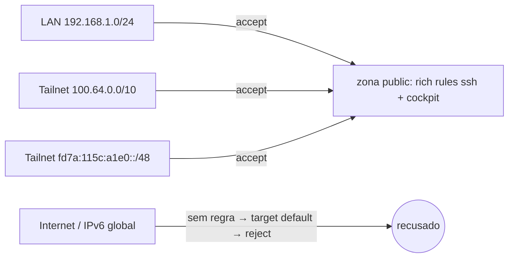

# firewalld — Restrição de serviços por origem (rich rules)

> Documento de estudo criado a 2026-10-18 (tarefa 25(d)). A configuração foi feita a 2026-10-15 e está registada em [infra/docs/03-ssh.md, secção 8](../../infra/docs/03-ssh.md#8-firewall-ssh-e-cockpit-só-a-partir-da-lan-e-da-tailnet-2026-10-15); aqui explica-se o porquê e cada peça.

---

## O que é

O **firewalld** é o serviço de firewall por omissão no RHEL (e Fedora, Rocky, Alma). Por baixo usa o **nftables** do kernel, mas trabalha com conceitos de mais alto nível:

- **Zona:** conjunto de regras com um nível de confiança (`public`, `home`, `trusted`, `drop`…). Cada interface de rede pertence a uma zona; o tráfego que entra por essa interface é avaliado pelas regras dela.
- **Serviço:** nome para uma ou mais portas/protocolos (`ssh` = 22/tcp, `cockpit` = 9090/tcp, `mdns` = 5353/udp). Definições em `/usr/lib/firewalld/services/`.
- **Rich rule:** regra em linguagem própria do firewalld que junta várias condições numa só: família (IPv4/IPv6), **origem**, destino, serviço ou porta, ação (`accept`, `reject`, `drop`), log e limites de taxa.

**Restringir por origem** quer dizer: um serviço não fica aberto a toda a gente que chega à interface, só a quem vem de redes concretas. Um `--add-service=ssh` simples abre a porta a **qualquer** origem; uma rich rule com `source address` abre-a só a essa rede.

---

## Aplicabilidade

- Servidores com **IPv6 global**: sem NAT, cada máquina tem endereço público; o "estar atrás do router" deixa de proteger por si só.
- Painéis de administração (Cockpit, Webmin, bases de dados) que **não devem** ser expostos à Internet mas precisam de acesso a partir da LAN ou de uma VPN.
- Defesa em profundidade: mesmo que a firewall do router falhe ou seja reconfigurada, a do servidor continua a filtrar.
- Exame RHCSA: gestão do firewalld (zonas, serviços, portas, `--permanent`/`--reload`) é objetivo direto; rich rules aparecem em cenários de "permitir só a partir da rede X".

Formas de restringir por origem no firewalld, da mais simples à mais fina:

| Mecanismo | Como | Quando usar |
|---|---|---|
| Zona por origem | `--zone=home --add-source=192.168.1.0/24` + serviços na zona `home` | Várias redes com políticas diferentes, muitos serviços |
| Zona por interface | `--zone=trusted --add-interface=tailscale0` | Uma interface inteira é de confiança (ex.: VPN) |
| **Rich rule** | `--add-rich-rule='rule … source address=… service name=… accept'` | Poucos serviços, restrição por serviço, mistura IPv4/IPv6 |

---

## Pertinência para este projeto

O homeserver tem, na `enp2s0`, um **IPv6 global** atribuído pelo ISP. Até 2026-10-15, `ssh` e `cockpit` estavam abertos na zona `public` a qualquer origem. Em IPv4 isso era contido pelo NAT do router; em IPv6 não há NAT, e o único travão era a firewall IPv6 do router, que nunca foi testada (o teste opcional foi abandonado pelo Ivan a 2026-10-18). O **Cockpit** era o caso grave: autentica pelo PAM e **continua a aceitar password** (o SSH já era só por chave).

Requisito: SSH e Cockpit acessíveis da LAN e da tailnet, mais nada.

Alternativas avaliadas:

| Alternativa | Problema |
|---|---|
| Confiar só na firewall do router | Não testada; uma mudança de router ou de firmware abria tudo sem aviso |
| Desligar o IPv6 no servidor | Parte mais do que resolve (DNS, Tailscale e serviços futuros podem usar IPv6) e esconde o problema em vez de o tratar |
| Pôr a `tailscale0` na zona `trusted` (sugerido em [01-tailscale-instalacao.md](01-tailscale-instalacao.md)) | `trusted` aceita **tudo** em todas as portas; não resolve a LAN nem o IPv6 global da `enp2s0`, que é onde está o risco |
| Zona `home` por origem (`--add-source`) | Funcionaria, mas são dois serviços só; uma zona extra é mais uma peça para manter e para explicar |
| Regra com o prefixo IPv6 global da LAN | O prefixo é do ISP e **pode mudar**; a regra deixaria de valer sem aviso |
| **Rich rules por serviço e por rede** (escolhido) | Explícito, por serviço, cobre IPv4 e IPv6 da tailnet; o IPv6 global fica de fora de propósito |

**Origens permitidas:**

| Origem | Rede | Porquê esta rede |
|---|---|---|
| LAN IPv4 | `192.168.1.0/24` | Rede de casa |
| Tailnet IPv4 | `100.64.0.0/10` | Intervalo CGNAT (RFC 6598) de onde a Tailscale atribui os IPs `100.x` |
| Tailnet IPv6 | `fd7a:115c:a1e0::/48` | Prefixo ULA fixo da Tailscale para todos os nós |



Nota: a `tailscale0` **não tem zona** atribuída (`--get-zone-of-interface=tailscale0` → `no zone`), por isso o tráfego da tailnet é avaliado pela zona por omissão, `public`. É isso que faz as rich rules da tailnet funcionarem.

---

## Comandos utilizados (homeserver, 2026-10-15)

### 1. Ver o estado inicial

```bash
sudo firewall-cmd --get-default-zone
sudo firewall-cmd --get-active-zones
sudo firewall-cmd --list-all --zone=public
```

- `sudo` — o firewalld exige root (ou autorização do polkit); sem ele: `Authorization failed`.
- `--get-default-zone` — mostra a zona usada para interfaces sem zona própria (aqui `public`).
- `--get-active-zones` — lista as zonas com interfaces ou origens associadas (aqui só `public` com `enp2s0`).
- `--list-all` — mostra tudo o que está na zona: interfaces, serviços, portas, rich rules, target.
- `--zone=public` — escolhe a zona; sem ele, o comando aplica-se à zona por omissão (dava o mesmo aqui, mas ser explícito evita surpresas se a omissão mudar).

### 2. Criar as rich rules e retirar os serviços abertos

```bash
for svc in cockpit ssh; do
  sudo firewall-cmd --permanent --zone=public --add-rich-rule="rule family=\"ipv4\" source address=\"192.168.1.0/24\" service name=\"$svc\" accept"
  sudo firewall-cmd --permanent --zone=public --add-rich-rule="rule family=\"ipv4\" source address=\"100.64.0.0/10\" service name=\"$svc\" accept"
  sudo firewall-cmd --permanent --zone=public --add-rich-rule="rule family=\"ipv6\" source address=\"fd7a:115c:a1e0::/48\" service name=\"$svc\" accept"
  sudo firewall-cmd --permanent --zone=public --remove-service=$svc
done
```

Opções do `firewall-cmd`:

- `--permanent` — grava a regra na configuração em disco (`/etc/firewalld/zones/public.xml`). **Sem ele**, a regra entra só na configuração em execução e perde-se no próximo `--reload` ou reboot. **Com ele**, não fica ativa até ao `--reload` (por isso a sessão SSH aberta não caiu durante o ciclo).
- `--zone=public` — a zona onde a regra fica (ver acima).
- `--add-rich-rule="…"` — acrescenta uma rich rule; se já existir uma igual, avisa `ALREADY_ENABLED` e não duplica.
- `--remove-service=$svc` — tira o serviço da lista de serviços abertos da zona. **Sem este passo**, o serviço continuava aberto a toda a gente e as rich rules não restringiam nada (um `accept` geral ganha a qualquer restrição).

Partes da rich rule:

- `rule` — início obrigatório da regra.
- `family="ipv4"` / `family="ipv6"` — a família de endereços. É **obrigatória** quando há `source address` (o endereço só faz sentido numa família); sem ela, o firewalld recusa a regra com `INVALID_RULE`.
- `source address="192.168.1.0/24"` — só se aplica a pacotes vindos desta rede (notação CIDR). Sem `source`, a regra valeria para qualquer origem, igual a um `--add-service`.
- `service name="$svc"` — o serviço pelo nome (as portas vêm da definição do serviço). Alternativa: `port port="22" protocol="tcp"`.
- `accept` — a ação: deixar entrar. Outras: `reject` (recusa com resposta, o cliente sabe logo), `drop` (descarta em silêncio, o cliente fica à espera até ao timeout).

Ordem dentro do ciclo: primeiro as regras, depois o `--remove-service`. Como tudo é `--permanent`, a ordem não muda nada até ao reload, mas fica a regra de ouro para quando se trabalha sem `--permanent`: **abrir o acesso novo antes de fechar o antigo**, para não ficar trancado fora.

### 3. Aplicar

```bash
sudo firewall-cmd --reload
sudo firewall-cmd --list-all --zone=public
```

- `--reload` — carrega a configuração permanente para a firewall ativa **sem cortar ligações estabelecidas** (ao contrário de `systemctl restart firewalld`). A sessão SSH aberta, a rede de segurança, mantém-se.
- `--list-all --zone=public` — confirmar: em `services` ficam só `dhcpv6-client mdns`, e em `rich rules` as seis regras.

Precaução usada: uma **sessão SSH aberta** durante toda a mudança e, como plano B, o terminal do Cockpit e a consola física.

---

## Teste de validação

### 2026-10-15 (a partir do asus, ver [03-ssh.md](../../infra/docs/03-ssh.md))

SSH e Cockpit funcionam por `homeserver.local`, `192.168.1.2`, `homeserver`, IP `100.x` e IP `fd7a:…` da tailnet. Pelo IPv6 global: Cockpit *connection refused*, SSH recusado na ligação.

### 2026-10-18 (revalidação a partir do asus, só portas TCP)

```bash
for t in 192.168.1.2 100.112.247.104 fd7a:115c:a1e0::da2e:f769 <IPv6-global>; do
  for p in 22 9090; do
    timeout 4 bash -c "exec 3<>/dev/tcp/$t/$p" && echo "$t:$p aberto" || echo "$t:$p recusado"
  done
done
```

- `timeout 4` — desiste ao fim de 4 s (um `drop` ficaria pendurado; um `reject` responde logo).
- `exec 3<>/dev/tcp/HOST/PORTA` — funcionalidade do bash que abre uma ligação TCP sem precisar de `nc`/`nmap`; se a ligação abrir, a porta está aceite.

| Destino | 22 (ssh) | 9090 (cockpit) |
|---|---|---|
| `192.168.1.2` (LAN) | aberto | aberto |
| `100.112.247.104` (tailnet IPv4) | aberto | aberto |
| `fd7a:115c:a1e0::da2e:f769` (tailnet IPv6) | aberto | aberto |
| IPv6 global da `enp2s0` | recusado | recusado |

O IPv6 global foi testado **a partir da LAN**: prova que a firewall do servidor o recusa, venha de onde vier, porque a origem (o IPv6 global do asus) não está em nenhuma regra.

### Por testar

- Nada obrigatório. O teste a partir da Internet (dados móveis, sem Tailscale) foi abandonado a 2026-10-18 (tarefa 25(c)); o teste acima já cobre a firewall do servidor, que é a que interessa.

---

## Comandos de referência e troubleshooting

```bash
# Estado da zona (serviços, portas, rich rules, target)
sudo firewall-cmd --list-all --zone=public

# Só as rich rules
sudo firewall-cmd --list-rich-rules --zone=public

# Diferença entre configuração em execução e em disco
sudo firewall-cmd --list-all --zone=public              # em execução
sudo firewall-cmd --list-all --zone=public --permanent  # em disco

# Copiar a configuração em execução para o disco (quando se testou sem --permanent)
sudo firewall-cmd --runtime-to-permanent

# Remover uma rich rule (texto exatamente igual ao que aparece na listagem)
sudo firewall-cmd --permanent --zone=public --remove-rich-rule='rule family="ipv4" source address="192.168.1.0/24" service name="ssh" accept'
sudo firewall-cmd --reload

# Zona de uma interface
sudo firewall-cmd --get-zone-of-interface=enp2s0
sudo firewall-cmd --get-zone-of-interface=tailscale0

# Ver as portas de um serviço
sudo firewall-cmd --info-service=cockpit

# Registar (log) tentativas recusadas, para diagnóstico (fica gravado no firewalld.conf: desligar no fim)
sudo firewall-cmd --set-log-denied=unicast
sudo journalctl -k -f | grep -i reject
sudo firewall-cmd --set-log-denied=off

# As regras nftables geradas (só leitura)
sudo nft list ruleset | less
```

Problemas típicos:

- **Regra aceite mas sem efeito:** o serviço continua em `services` (o `accept` geral ganha). Tirar com `--remove-service`.
- **Funcionou e desapareceu depois do reboot:** foi aplicada sem `--permanent`. Usar `--runtime-to-permanent` ou repetir com `--permanent`.
- **`--permanent` e nada mudou:** falta o `--reload`.
- **IPv6 recusado mas IPv4 aceite (ou o contrário):** a rich rule é por família; cada família precisa da sua.
- **Trancado fora:** consola física ou terminal do Cockpit (pela LAN/tailnet). Em último caso, no arranque, `systemctl stop firewalld` a partir da consola.

---

*Faz parte do projeto [Home Server + Tailscale](../../README.md)*
